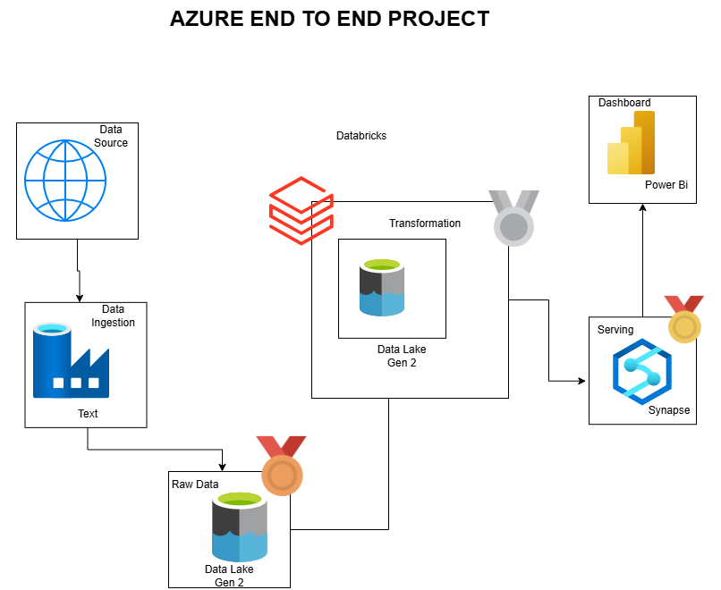
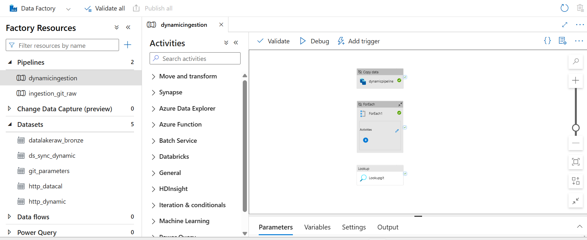
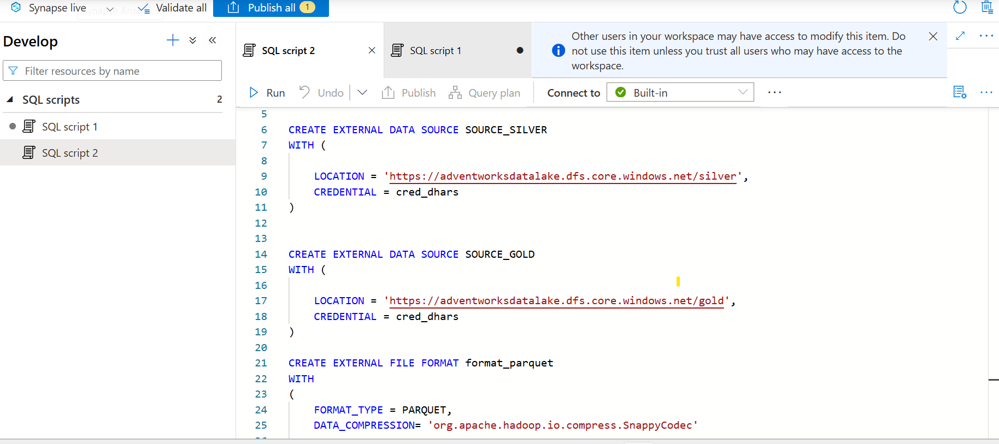
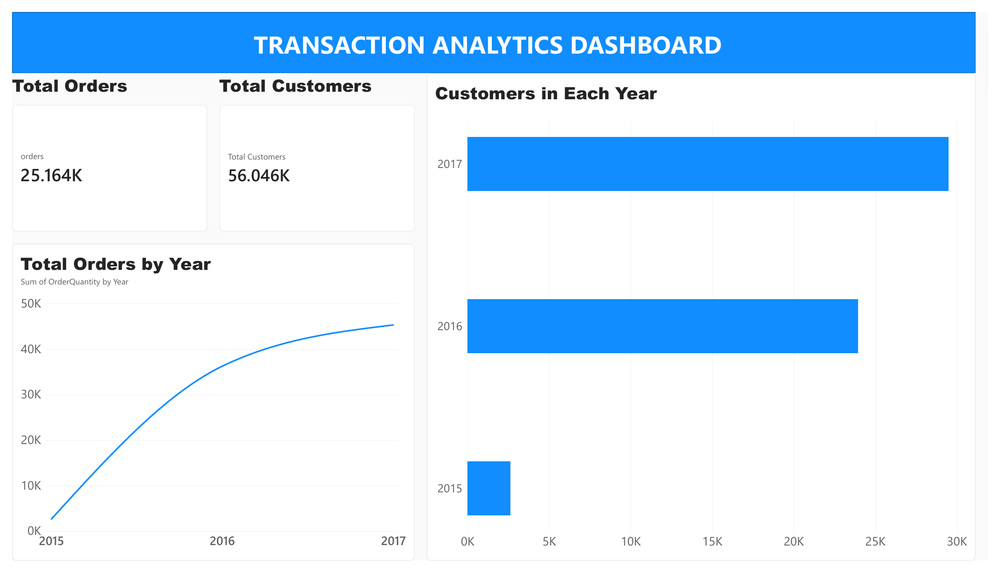

# Azure End to End Data Pipeline: Adventure Works Sales Analytics

An end to end data engineering project on Azure. Raw Adventure Works CSV files
are pulled from GitHub over HTTP by Azure Data Factory into Azure Data Lake
Storage Gen2 (Bronze), cleaned in Azure Databricks and saved as Parquet
(Silver), exposed through Azure Synapse Analytics (Gold), and visualized in a
Power BI dashboard.

## Architecture



| Layer | Tool | What happens |
|-------|------|--------------|
| Ingestion | Azure Data Factory | Parameterized pipeline copies the CSV files from GitHub (HTTP) into the data lake |
| Bronze | ADLS Gen2 | Raw CSV files stored as received, one folder per table |
| Silver | Azure Databricks | PySpark cleans and transforms the data, writes Parquet through an external location |
| Gold | Azure Synapse Analytics | Serverless SQL view and external table over the Silver sales data |
| Reporting | Power BI | Dashboard built on the Gold layer |

## Dataset

[Adventure Works on Kaggle](https://www.kaggle.com/datasets/ukveteran/adventure-works)
(by ukveteran). The raw files are in [`source_data/`](source_data/):

| File | Rows |
|------|------|
| Sales 2015, 2016, 2017 | 2,630 / 23,935 / 29,481 |
| Customers | 18,148 |
| Products | 293 |
| Product Subcategories | 37 |
| Product Categories | 4 |
| Territories | 10 |
| Returns | 1,809 |
| Calendar | 912 |

## Pipeline Walkthrough

### 1. Ingestion (Azure Data Factory)
The `dynamicingestion` pipeline uses a Lookup activity, a ForEach loop and a
Copy activity with parameterized HTTP source and data lake sink datasets, so
one pipeline loads every file instead of one pipeline per file. Files land in
the `bronze` container, for example `bronze/sales_2015/sales_2015.csv`.



### 2. Silver layer (Azure Databricks)
The notebook [`databricks/silver_layer.ipynb`](databricks/silver_layer.ipynb):

- Creates a Unity Catalog external location for the `silver` container
- Reads each Bronze CSV with PySpark
- Adds `Year` and `Month` columns to the calendar table
- Simplifies the product SKU and product name columns
- Combines the three yearly sales files into one `sales` table with `unionByName`
- Writes every table to the `silver` container as Parquet

### 3. Gold layer (Azure Synapse Analytics)
The scripts in [`synapse/`](synapse/) run on the serverless SQL pool:

1. [`01_setup_external_sources.sql`](synapse/01_setup_external_sources.sql) creates the external data sources for Silver and Gold and the Parquet file format
2. [`02_gold_layer.sql`](synapse/02_gold_layer.sql) creates the `gold` schema, the `gold.sales` view over the Silver data, and the `gold.extsales` external table that writes the result to the Gold container



### 4. Dashboard (Power BI)
The Transaction Analytics dashboard is connected to the Gold layer. It shows
total orders, order line volume, yearly order quantity, and yearly growth.
The exported report is in [`powerbi/dashboard.pdf`](powerbi/dashboard.pdf).



## Key Results

- Ingested 10 source files through a single parameterized ADF pipeline
- Processed 56,046 sales order lines across 25,164 orders
- Sales volume grew from 2,630 order lines in 2015 to 29,481 in 2017

## Tech Stack

Azure Data Factory, Azure Data Lake Storage Gen2, Azure Databricks (PySpark,
Unity Catalog), Azure Synapse Analytics (serverless SQL), Power BI

## Repository Structure

```
azure_end_to_end_project/
├── source_data/          raw Adventure Works CSV files
├── architecture/         architecture diagram
├── databricks/           Bronze to Silver notebook
├── synapse/              Gold layer SQL scripts
├── powerbi/              dashboard export and screenshot
└── docs/images/          pipeline and Synapse screenshots
```

## How to Reproduce

1. Create an ADLS Gen2 storage account with `bronze`, `silver` and `gold` containers
2. Build the ADF pipeline to copy the files from `source_data/` into Bronze
3. Create the Databricks external location and run `databricks/silver_layer.ipynb`
4. Run the Synapse scripts in order
5. Connect Power BI to the Synapse serverless SQL endpoint and build the report

## Next Steps

- Add more Gold tables (customers, products, territories, returns) for a full star schema
- Add trigger based scheduling in Data Factory
- Use overwrite or incremental loads in Databricks so reruns do not duplicate data

## Contact

dharsana263@gmail.com | [LinkedIn](https://linkedin.com/in/dharsanamurugiah) | [Portfolio](https://dharsana2025.github.io)
